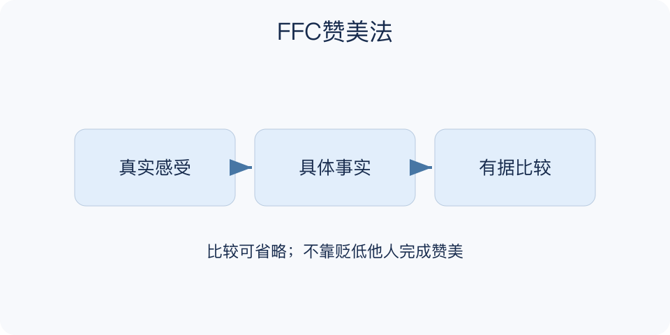

# FFC赞美法：一分钟看懂

> 基于通用知识整理，尚未与视频内容核对。
> 内容类型：通用知识版

**版本与边界：** 采用中文传播中常见的Feeling—Facts—Compare（感受—事实—比较）版本。首创者及视频具体释义未确认；本稿不将它说成经验证实的心理学定律。

“你真厉害”很热情，却没有告诉对方哪里做得好。FFC把赞美拆成真实感受、具体事实和有依据的比较，让感谢或肯定更清楚。这里采用感受—事实—比较版本；比较可以对照本人之前的做法，不必把别人压低。

- 感受属于自己：说“我更容易理解了”，避免替所有人表态。
- 事实能被指出：说明哪次行为、哪个细节，而非堆形容词。
- 比较需要基准：对照前一版本或原先目标，才有实际含义。
- 尊重接受方式：公开表扬还是私下表达，应考虑对方偏好。

回想一件刚发生的小事，先写你真实感受到的帮助，再补一处行为证据。确有合适基准才加比较；没有时，两句具体感谢已经足够。

不要为了凑齐三个字母夸张排名、捏造效果，或把赞美变成索取回报的铺垫。模型只能整理表达，真诚无法靠句式保证。

一个检查办法是删掉所有赞美形容词，看剩下的信息是否仍能让对方知道自己贡献在哪里。如果只剩“太好了”，就补事实；如果事实已经完整，不需要再人为拔高。

## 适用范围与注意事项

适合日常感谢、同事协作、向上反馈、团队表扬、沙龙致谢和具体成长反馈。职场中优先肯定行为、方法与贡献，考虑公开或私下表达的偏好；不以 FFC 代替纠错、正式绩效评价或任务安排。

比较优先对照本人过去的表现或作品版本，没有基准就省略。不要夸一个、踩一个，也不要把“你做得好”接成“所以以后都由你做”。对方可以纠正你的观察，或不接受这种赞美方式。

更多见[适用范围](明细.md#适用范围)、[使用注意事项](明细.md#使用注意事项)与[常见问题列表](明细.md#常见问题列表)。

文字依据见[明细的参考资料](明细.md#文字参考)。

[模型主页](README.md) · [一分钟看懂](一分钟看懂.md) · [明细](明细.md) · [案例](案例.md)
