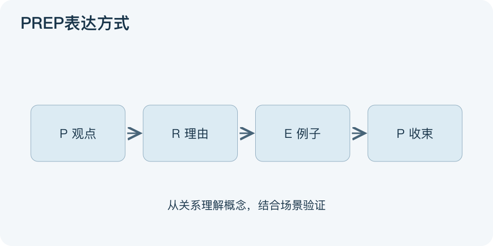

# PREP表达方式：一分钟看懂

> 基于通用知识整理，尚未与视频内容核对。
> 内容类型：通用知识版

被问“你建议怎么做”时，先把所有背景倒出来，听众可能等不到答案。PREP按Point、Reason、Example、Point组织简短表达：先给观点，再说理由，用例子支撑，最后收束到观点或行动。

- 观点是一句能讨论的判断，不只是主题名。
- 理由说明为何采取这个判断，别仅把观点换词重复。
- 例子把理由具体化；个案可帮助理解，不能自动证明普遍规律。
- 结尾重申适用范围或下一步，不必逐字再念开头。

最简做法是写四句：我建议什么，因为哪个主要理由，例如什么情况，因此现在请做什么。图的四步表示听众接收论证的顺序，不表示结论在搜集证据之前就应固定。

本文采用常见的即兴表达版本。适合短汇报、回答建议类问题；复杂争议可拆成多个论点并提供完整证据。误区是开头强下结论，随后只挑支持自己的例子。若资料不足，可以把观点说成“建议先验证”，清晰表达也包括清晰承认不确定。

## 使用时最容易错的五件事

- **把主题当观点**：“说一下项目”没有回答希望对方判断什么。
- **用观点解释观点**：“应该改，因为现在不好”缺少具体理由。
- **让故事承担过大的结论**：一个成功或失败案例不能直接推到所有人。
- **结尾换了请求**：申请试验不能在结尾突然变成要求全面推广。
- **遇到追问继续背四句**：应补证据、回应问题，必要时改变观点。

先确认对方需要建议还是倾听；表达一个主要判断，保留关键条件。用 **例子→理由→观点** 反向检查支撑关系，末尾回到同一判断或明确下一步。更多提醒见[使用注意事项](明细.md#使用注意事项)与[常见错误清单](明细.md#容易犯错的地方与纠正办法)。

## 批评或反对时，不必直接“观点先行”

逻辑成立不代表对方容易接受。PREP 可以帮助自己整理思路；面对行为反馈或敏感异议，可先了解情况、连接真实的共同目标，再说明具体顾虑并邀请调整。婉转不是虚假赞同，也不是隐藏问题：事实、影响和请求仍需清楚，并允许对方回应。详见[批评与反对意见的使用边界](明细.md#批评与反对意见逻辑清楚也要照顾接受感受)。

文字依据和适用边界见[明细](明细.md)。

[模型主页](README.md) · [明细](明细.md) · [案例](案例.md)
