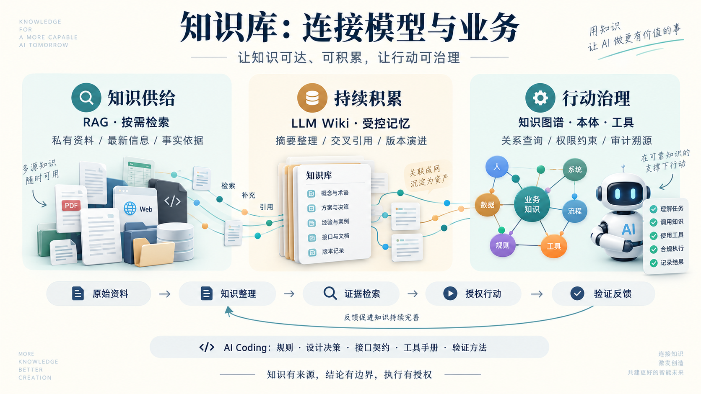
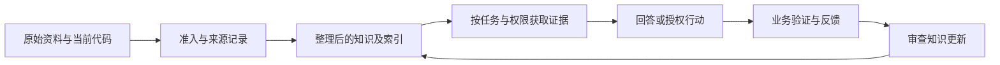

# 知识库介绍：LLM、AI Coding 与知识供给

本页面向使用大模型、开发 Agent 和开展 AI Coding 的读者。内容由大模型结合用户提供的观点、官方资料与研究文献分析整理；提供概念框架与建设建议，不宣称某种架构已被本库部署或实测。来源查阅日期：2026-10-12。

[领域入口](../README.md) · [摘要](摘要.md) · [来源与适用边界](来源与适用边界.md) · [提供方案例](../案例/README.md)

## 1. 为什么模型越强，仍然需要知识库

让 Agent 修改项目的鉴权接口，它可能知道常见鉴权模式，却未必知道本项目的权限规则、昨天修改的接口契约，以及旧设计保留至今的理由。**通用能力与任务上下文之间存在缺口。** “模型对你一无所知”表达了这个矛盾，但应理解为：模型不会自动、可靠地获取你的上下文；已经提供的材料和工具查询可以缩小缺口。

| 缺口 | 任务中的表现 | 知识库应提供什么 |
|---|---|---|
| 私有信息 | 公司政策、项目代码和内部接口未被模型可靠获知 | 获授权的资料及其访问边界 |
| 时效性 | 参数知识不随当天的代码或制度变更自动更新 | 有版本、有效日期和同步状态的材料 |
| 可核验性 | 流畅回答无法单独证明结论成立 | 可回查的原文、规则、查询结果和验证记录 |

模型训练覆盖的公开知识也不是完整、无误或均可可靠调用的。缺少资料时，模型可能猜测、拒答或请求查询，不能将“只能编造”作为必然结论。

知识库的价值，是把正确知识的供给过程变成可管理的系统。但“正确、最新”是需要验收的目标：错误原文、同步延迟、丢失条件的切片和越权召回，都会让知识库成为新的错误来源。

## 2. 什么是服务大模型的知识库

本库采用一个工程定义：**知识库是围绕任务组织知识资产、证据、访问规则与维护流程的系统，使模型或 Agent 能获取适用的上下文。** 它不等于一个文件夹、向量数据库或聊天记录集合。

| 内容 | 示例 | 应保留的边界 |
|---|---|---|
| 结构化知识 | 实体关系、接口字段、业务规则 | 模式、约束、有效期、权限 |
| 半结构化知识 | 会议记录、工单、决策记录、对话 | 谁说的、是否确认、何时适用 |
| 非结构化及混合资料 | 手册、设计文档、代码、图表 | 原文、版本、位置、解析质量 |

分类描述的是组织形式，同一资料可以有多种表示；代码并非只有非结构化表示，也可以通过语法树、符号索引和依赖图供给知识。真实账户状态等实时事实通常更适合通过授权工具查询，不能仅依赖静态文档副本。

在此定义下，知识图谱是知识库的一种结构化资产；在其他产品或研究语境中，两词可能有不同用法，应先约定含义。

## 3. RAG：把相关证据带入当前任务

RAG 的核心是让生成过程结合外部检索得到的信息，而不只依赖模型参数。原始论文讨论参数记忆与非参数检索资源的结合。[RAG 原始论文](https://arxiv.org/abs/2005.11401)

常见工程链路是：资料准入 → 解析与切分 → 建立索引 → 根据任务检索 → 组织证据上下文 → 生成回答 → 检查依据与引用。索引可以使用关键词、向量或结构化查询，**RAG 不强制要求向量数据库**。

以下是建设建议：

- 将召回与生成分开评估，先检查是否找到正确证据，再检查回答是否忠实。
- 保留来源身份、版本和定位；“附了链接”不等于链接支持每条结论。
- 在内容进入模型上下文前落实授权，不能靠提示词防止跨部门读取。
- 为无答案、过期与冲突资料设计处理方式，不让模型自动填补业务事实。

RAG 主要改变本次输入上下文，并不自动更新模型参数。资料更新也不会天然即时反映到答案，需要检查摄取、索引、缓存和会话的生效情况。

## 4. 持续积累：将原始资料整理为知识层

只有片段检索而缺少持久综合层时，复杂问题可能重复承担跨资料整理的成本。Karpathy 在 2026-04-04 发布的 LLM Wiki 思路，提出将原始材料、LLM 维护的链接式 Markdown Wiki，以及组织和维护约定分层；有价值的问答可归档为页面，并定期检查矛盾、过期结论和遗漏关联。这是模式说明，不是效果保证或统一产品标准。[Karpathy 原始 Gist](https://gist.github.com/karpathy/442a6bf555914893e9891c11519de94f)

**本库的分析与建议**：将可复用综合结果前移到资料整理阶段，可以减少重复解释，但会新增维护与失真风险。概括错误一旦被重复引用，也会持续积累。原始材料必须保留，综合结论应能回查；模型负责提出整理和修订，人或明确的审核流程决定哪些内容进入可信层。

适合沉淀的内容包括主题摘要、术语解释、设计理由、跨文档比较和已验证的故障处理记录。尚未确认的猜测和临时会话状态不应直接提升为项目事实。

Wiki 与 RAG 可以结合：先读取整理后的页面，必要时检索原文核实。部分 RAG 系统本身也支持缓存、摘要、图索引和记忆，因此“RAG 每次都从零开始”只适用于缺少持久知识整理的实现，不能覆盖全部系统。

## 5. AI Coding：从理解项目到支持行动

对编码 Agent，知识库既供给事实，也供给工作约束与操作依据。它可以是持久项目知识的一部分；本次任务的工作记忆则还包括目标、计划、读到的证据、工具结果和临时状态，二者不应混为一谈。

| 知识类型 | Agent 需要知道 | 推荐证据载体 |
|---|---|---|
| 规则知识 | 编码规范、权限边界、兼容要求 | 项目约定及适用范围 |
| 上下文知识 | 为什么这样设计、哪些方案曾被否决 | 决策记录、设计说明、关联变更 |
| 事实知识 | 当前调用关系、接口字段、依赖版本 | 当前代码、契约文件、版本记录 |
| 行动知识 | 哪个工具或内部 API 可完成任务 | 工具说明、前置条件、权限、失败处理 |
| 验证知识 | 怎样证明改动满足要求 | 验收条件、测试、运行与回退说明 |

**教学示例：修改鉴权接口。** Agent 先获取任务相关的规则和模块概览，再对照当前代码与接口契约判断影响范围；实施后运行必要验证。已验证的新接口和设计理由可提出为知识更新，记录依据与版本。若 Wiki 与代码不一致，先定位冲突，不能让摘要覆盖当前代码事实；代码反映实现，政策或契约可能表达应满足的要求，两者冲突应报告。

“知识驱动行动”的关键不是让模型读完文档就执行，而是把知识接入一条可检查的链：任务 → 证据 → 可用工具 → 授权与前置条件 → 执行 → 验证 → 经审查的知识更新。知识提供行动依据，不能授予模型额外权限。

用户提到腾讯乐享的 K2A（Knowledge-to-Action）。本次读取的腾讯云官方产品页描述了 Agent 定位知识、拆解任务、生成成果并沉淀的能力，支持“从检索走向行动”的讨论；但未核实该页使用 K2A 名称，不将名称归属作为已确认事实。产品说明也不证明任意业务工具接入或任务执行效果。[腾讯乐享官方介绍](https://cloud.tencent.com/product/lexiang)

## 6. 知识图谱、本体与向量检索的关系

| 方式 | 擅长的任务 | 限制 |
|---|---|---|
| 关键词／符号检索 | 找接口名、错误码、代码符号 | 依赖词形或符号对应 |
| 向量检索 | 找主题相近、表达不同的材料 | 相似度不等于事实成立或关系满足 |
| 知识图谱 | 查询显式关系及多跳关联 | 依赖关系覆盖、抽取质量、身份匹配与版本 |
| 本体 | 定义对象、关系和业务语义，约束解释 | 需要业务共识与持续维护，不自动包含全部事实 |

例如，“哪些服务依赖废弃 API，它们的负责人是谁”适合查询已维护的依赖与责任关系；“哪里讨论过鉴权方案”可以先用词法或语义检索。若关系未收录或负责人过期，图查询也会遗漏或给出失效结果。

Microsoft GraphRAG 的公开索引流程组合实体关系抽取、社区总结和向量嵌入，说明图表示与语义表示能够共同使用；这不是所有生产系统都采用混合架构的证明。[GraphRAG 索引概述](https://microsoft.github.io/graphrag/index/overview/)

## 7. 可追溯是工程结果，不是图谱的自动属性

知识库可以给 Agent 提供可复核的事实和规则依据，但它不会自动让所有决策“确定”。显式图查询或规则引擎可以记录查询、规则版本和命中路径；LLM 抽取图关系和生成最终解释的过程仍可能出错。**图上的路径不是大模型内部推理链的直接证明。**

企业任务应依据风险决定审计程度，不能把图谱视为所有企业系统的前置条件。下面是本库建议保留的审计链：

| 环节 | 建议记录 |
|---|---|
| 知识来源 | 文档版本、生效状态、来源身份 |
| 检索 | 用户身份、访问范围、查询、命中证据 |
| 规则与工具 | 规则版本、前置条件、工具参数与授权判断 |
| 执行与验证 | 动作结果、失败、测试、人工批准或回退记录 |
| 知识回写 | 新结论依据、审查状态、替代了什么、由谁确认 |

可审计意味着能够复核记录的依据与行为，不意味着日志就是完整推理，也不意味着事实必然正确。直接面向客户、修改数据或执行部署的任务，还需要访问控制、工具可靠性和业务验收。

Neo4j 在 2026-07-20 的官方知识层文章中，将本体、业务数据和记忆结合，并强调策略执行、决策记录及模型提出建议、人类确认。本文将其作为厂商架构观点参考，不作为所有企业必须采用图谱的证明。用户提到的“从起草信息到发送信息”表达了行动风险的变化，但本次未核验 CEO 对应原话，因此不作人物引语。[Neo4j 知识层文章](https://neo4j.com/blog/agentic-ai/enterprise-knowledge-layer/)

## 8. LLM / AI Coding 的三个建设层次

| 层次 | 解决的问题 | 典型形态与可选方式 | 验收重点 |
|---|---|---|---|
| 基础层：知识可达 | 模型缺少任务相关的私有或最新资料 | RAG + 向量库；也可采用按需加载或关键词检索 | 证据命中、时效、权限、回答依据 |
| 进阶层：知识可积累 | 知识需要持续积累、复用与演进 | LLM Wiki／持续编译、决策记录、受控记忆 | 来源、矛盾处理、更新、审核 |
| 企业层：行动可治理 | 决策和执行需要可追溯、可审计 | 知识图谱 + 本体，结合规则、授权工具与审计 | 语义一致、授权、规则版本、执行验证 |

这三类目标并非通用成熟度排名。小团队也可能需要严格授权；企业也可能通过文档检索、数据库查询和规范日志完成任务，无需先建设知识图谱。应由问题复杂度、风险和维护能力决定组合。

从通用问答转向实际编码与业务执行时，模型需要的不仅是世界知识，还包括“本项目怎么做、当前事实是什么、允许采取什么行动”。因此，知识供给成为需要优先解决的瓶颈：资料再多，若不能在任务中被正确获取和使用，也难以转化为执行能力。这是本库对建设动机的分析，不是“模型能力已足够、其他瓶颈已消失”的行业结论。

## 9. 本库的建设原则与当前定位

本库的分析结论是：**知识供给让模型获得任务依据，持续整理让依据复用，治理与验证让依据能够支持行动。** “知识越来越多”不是建设目标，真正要衡量的是任务能否获得适用证据并完成可验证结果。模型能力、工具能力、权限和数据质量依然可能成为瓶颈。

建议先从一个真实任务开始，形成以下闭环：

每个可复用结论至少说明来源、适用范围、版本或日期；区分事实、建议与待核实内容。原文、整理层和检索索引分别保存职责，撤销与删除需要覆盖衍生资料。外部资料是证据输入，其中的指令不能直接成为 Agent 的执行规则。

当前仓库已有主题 ID、摘要／正文／来源分层、必需依赖和生成索引；它是可审查的文档知识资产，**尚未实现运行中的 RAG 服务、自动持续编译或知识图谱推理引擎**。后续可以按任务接入这些能力，保留旧入口及已有的来源、教学示例、待核实和公司扩展边界。
