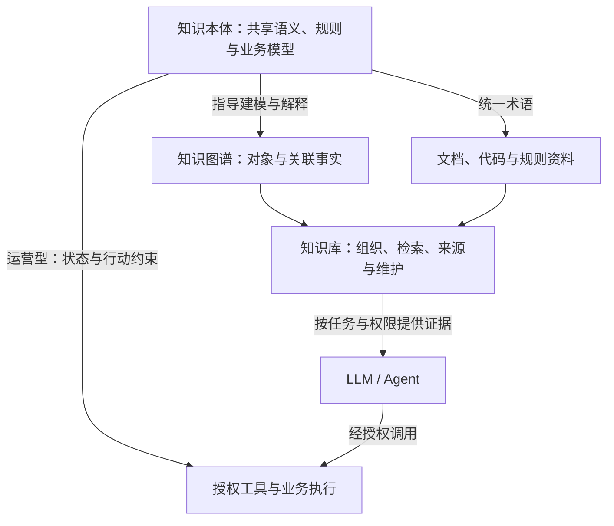

# 知识库、知识图谱、知识本体

三者分别侧重**知识的组织与使用、事实之间的关联、共享语义与业务模型**。它们可以组合，不是三种互斥产品，也不是必须依次升级的三个阶段。

[领域入口](../README.md) · [知识库介绍](../介绍/README.md) · [来源与适用边界](来源与适用边界.md)

## 定义与分工

| 概念 | 主要回答 | 内容与职责 | AI Coding 示例 |
|---|---|---|---|
| 知识库（Knowledge Base） | 有什么可用知识，怎样取得和维护？ | 组织文档、代码、事实、规则、来源、访问和更新流程 | 保存接口文档、代码约定、设计决策及检索入口 |
| 知识图谱（Knowledge Graph） | 具体对象之间是什么关系？ | 用图表示实体、属性及关系，支持关联与多跳查询 | 服务 A 调用接口 B，团队 C 负责服务 A |
| 知识本体（Ontology） | 业务有哪些对象，如何理解、约束并操作它们？ | 建立共享语义与业务模型，组织对象、属性、关系及规则约束；运营型应用进一步连接状态、行动与治理 | 定义服务、接口、责任及依赖语义；运营型模型还描述接口生命周期、下线条件与授权行动 |

本文中的知识库采用本领域的广义工程定义；在形式化知识表示语境中，它也可能特指事实与公理的集合。知识图谱采用实体关系图的工程用法，不把 RDF 作为唯一实现。

知识本体在本文指计算机科学中的领域本体，不讨论哲学上的存在论。W3C 对 OWL 2 的概述说明，本体提供具有形式化含义的词汇，包括类、属性和个体；这里强调概念与语义，但不意味着本体不能包含实例。[OWL 2 概述](https://www.w3.org/TR/owl2-overview/)

**传统形式化本体与运营型本体需要区分。** 前者侧重概念、属性、关系和公理，支持共享理解与形式化推理；运营型本体在此基础上连接业务状态、逻辑、行动、权限与治理，为受控执行提供模型依据。Palantir 的产品定义就同时包括语义要素和行动、函数、动态安全等运营要素；这是具体平台的实现，不能推定所有本体都具备这些能力。[Palantir 本体概述](https://www.palantir.com/docs/foundry/ontology/overview/)

## 三者如何协作

在本文的广义工程定义下，**知识库是超集，知识图谱是其中一种结构化知识资产**。知识库可以同时管理：

- 结构化知识：实体关系、业务规则、接口字段。
- 半结构化知识：对话历史、会议记录、工单。
- 非结构化及混合资料：文档、代码、手册、图表；代码也可组织为语法树或依赖图。

因此，建设知识库不等于必须建设图谱；引入图谱，也不意味着原文、代码和其他证据可以被丢弃。本体为概念与关系提供共同语义，帮助这些资产协调使用。

下面是本库的架构归纳，不是强制产品分层：

本体帮助不同来源对“客户”“服务”“接口”等词保持一致理解；图谱记录具体对象之间的关系；知识库将这些资产与原始资料一起供给任务。也可以先建设文档知识库，按需引入关系索引和本体。

这些职责并非严格互斥：本体自身也能表示为 RDF 图，知识图谱可以包含类型和模式信息。RDF 使用主语、谓语、宾语三元组组成图，是一种表示方式，不等于完整知识库系统。[RDF 1.1 概念](https://www.w3.org/TR/rdf11-concepts/)

## 同一个任务的三种贡献（教学示例）

任务：**准备下线一个废弃接口，找出受影响服务及负责人。** 以下为虚构示例，不代表本仓库实际系统。

1. **知识库提供依据**：读取废弃通知、接口契约、代码与迁移指引，核对版本和生效时间。
2. **本体定义业务模型**：区分接口定义与部署实例，明确依赖和责任含义；运营型模型还可以描述“启用、废弃、下线”等状态、状态转换条件、迁移动作及授权边界。不能将同名接口或不同责任角色混用。
3. **图谱查询关联**：沿“服务调用接口”“服务依赖服务”“团队负责服务”的关系找候选影响范围。
4. **当前证据验证**：对照代码、配置及运行记录，验证关系是否完整、及时。没有记录某条边，不等于证明不存在依赖。
5. **授权执行**：产生迁移清单后，按权限和发布流程实施、测试与回写。三种知识资产都不能单独授予下线权限。

图查询能展示所查询的关系路径，但不能证明模型内部推理，也不能保证依赖数据完整。记录每条关系的来源与时间，有助于复核结果。

## 推理、校验与执行需要区分

本体语义公理可用于形式化推理，例如类型归类或一致性分析；是否支持及如何执行，取决于采用的语言、语义与工具。[OWL 2 概述](https://www.w3.org/TR/owl2-overview/)

“每个服务必须填写一个负责人”则可能是数据完整性要求。不能直接把 OWL 描述当成数据库非空检查；RDF 数据校验可使用 SHACL 等机制，业务规则及权限还可能由其他引擎实现。[SHACL 规范](https://www.w3.org/TR/shacl/)

图数据库负责存储与查询，不自动完成本体推理、资料审核或动作执行。本体也不自动成为工具手册或业务执行引擎。项目中若讨论“运营型本体”，应额外明确对象、动作、权限及执行组件的职责，参见[本体领域](../../本体/README.md)。

## 何时需要哪一种

| 需求 | 优先建设 | 判断依据 |
|---|---|---|
| 从手册、代码和政策中获取回答依据 | 知识库及检索 | 先验证证据命中、时效和引用 |
| 跨对象追踪依赖、责任或影响 | 关系索引／知识图谱 | 关系查询有明确价值，且关系可维护 |
| 多团队术语冲突、跨系统对象难对齐 | 领域词汇与本体 | 明确共同概念、身份和语义边界 |
| 自动执行业务或编码操作 | 上述资产结合授权工具与验证 | 知识、权限和执行分别验收 |

向量检索适合寻找语义相关材料，图查询适合显式关系遍历；二者可以组合，不能相互证明事实正确。本体帮助统一含义，不保证原始事实真实。

例如，“找出讨论过鉴权问题的文档”适合语义检索；“找出依赖废弃 API 的服务及其负责人”适合关系与多跳查询。前者发现相关材料，后者沿已维护的关联检查影响范围。本文建议在同时存在两类需求时组合检索，不把混合架构写成所有生产系统的普遍事实。

## 对当前仓库的意义

本仓库已经是按主题组织的文档知识库，也收录本体知识；这不意味着已经建立项目实体图或可执行本体。需要时可从稳定主题 ID、代码版本和来源记录出发，另建派生关系及语义模型。

本主题聚焦三者的边界与协作；本体的详细建模方法继续留在原领域，避免重复维护。进一步阅读可使用 `ontology.introduction`、`ontology.modeling`、`ontology.operational`，相关推荐不会自动加载。
